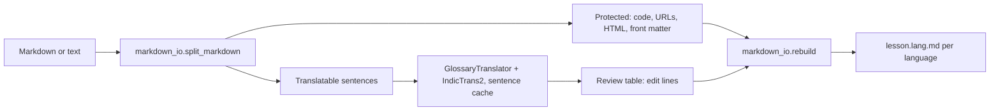

# LessonLingo architecture

LessonLingo turns English lectures and lessons into Indian languages on the user's own
machine. Models are downloaded once during setup. After that, translating needs no internet
connection.

## Data flow: lecture video (headline flow)

```mermaid
flowchart LR
    A[Lecture video, audio or .srt] --> B{Is it .srt or .vtt?}
    B -- yes --> F[Parse cues]
    B -- no --> C[ffmpeg: 16 kHz mono WAV]
    C --> D[faster-whisper: English cues with timestamps]
    D --> E[Free the speech model]
    E --> T[Teacher fixes the English transcript, doubtful lines marked]
    T --> F
    F --> G[GlossaryTranslator: protect kept words]
    G --> H[IndicTrans2: translate each cue, per language]
    H --> I[Restore kept words]
    I --> J[Review table: teacher edits lines]
    J --> K[.srt and .vtt per language]
    K --> L[Player with subtitles + downloads]
```



Rules that shape the flow:
- The speech model is freed before IndicTrans2 loads, so they never share the GPU.
- Timestamps never change. Doubtful lines (low recognition score) are marked for the teacher. Only the text of each cue is replaced.
- An uploaded `.srt` skips speech recognition. This is the demo fallback.

## Data flow: text lesson



## Interfaces

| Module | Public interface | Notes |
| --- | --- | --- |
| `translator.py` | `Translator.translate(sentences, tgt_lang)`, `close()`; `FakeTranslator`, `IndicTransTranslator(mode, device, batch_size)` | Lazy model load. Quality = 1B on GPU, light = 200M. |
| `glossary.py` | `GlossaryTranslator(inner, terms, preferred)`, `parse_terms`, `load_glossary` | Wraps any translator. Re-translates a sentence if a placeholder is lost. |
| `markdown_io.py` | `split_markdown(text) -> list[Segment]`, `rebuild(segments, translations)` | Round trip is exact for protected parts. |
| `pipeline.py` | `translate_segments`, `translate_text`, `translate_file`, `translate_folder` | Caches identical sentences within a run. |
| `subtitles.py` | `Cue`, `parse_subtitles`, `load_subtitles`, `to_srt`, `to_vtt`, `with_text`, `wrap_text` | SRT and WebVTT. Wraps at 42 characters. |
| `video.py` | `Transcriber`, `FakeTranscriber`, `FasterWhisperTranscriber`, `extract_audio`, `translate_video`, `embed_subtitles` | Status callback reports each stage. |
| `workspace.py` | `Workspace(root)`, `create_course`, `add_file`, `list_items`, `translate_course`, `trash_item`, `course_pack` | Courses on disk. Lectures are all transcribed first, then all translated. |
| `library.py` | `build_library_tab(...)` | The Courses tab. |
| `tts.py` | `Synthesizer`, `FakeSynthesizer`, `MMSSynthesizer`, `render_dub`, `dub_subtitles`, `add_voice_only`, `add_dubbed_audio`, `make_synthesizer` | Optional spoken dubbing for Hindi and Kannada: Indic Parler-TTS (natural) or Meta MMS (fallback), chosen by `make_synthesizer`. CLI flag and an Options checkbox in the app. |
| `pack.py` | `make_class_pack(files, zip_path)` | Zip with START_HERE.txt for sharing. |
| `setup_models.py` | `run_setup`, `run_verify`, `enable_offline_mode` | Downloads IndicTrans2 1B and 200M plus the Whisper model. |
| `app.py` | `build_app(holder, transcriber_factory)`, `run_translation`, `run_video_job`, `review_rows`, `save_review`, `ModelHolder` | Gradio UI. `ModelHolder` keeps one model and frees it on mode change. |
| `cli.py` | `lessonlingo translate / video / app / setup / verify / languages` | `--offline`, `--keep`, `--mode`, `--whisper`. |

Every real backend has a fake with the same interface, so tests and Mac development never
download a model.

## UI system

The interface is plain, bright and roomy. Beginners should know what to do in one look.

| Token | Value | Use |
| --- | --- | --- |
| Ground | `#f6fbf7` | Page background |
| Card | `#ffffff` with `#dcebe1` border, 20px radius | Each step |
| Ink | `#12261b` | Text |
| Green | `#16803c` | Primary buttons, selected state |
| Mint | `#e8f7ed` | Selected chips, notes |
| Mustard `#f5b524`, coral `#ea7b78`, blue `#8fb4e3`, red `#e2461f` | Halloween accents only: the colour strip, pixel pumpkin, ghost and bat |
| Fonts | Figtree (text), Space Mono (small labels) | Base size 16 to 17px, buttons are whole words |

Layout (one step on screen at a time):
- **Lecture tab:** a step bar (Add, Check, Watch). Add: drop area, language tiles, folded Options
  (run mode, kept words, glossary, dubbing), one big Continue button. Check: the English
  transcript table with doubtful words marked, Back and Translate. Watch: language buttons above the
  player, voice player, downloads, Translate another lecture.
- **Lesson tab:** Add, then Review (editable translation table, save, downloads).
- **Courses tab:** course picker, file adder, table, Translate everything.
- One spacing system: 720px page, 22px between blocks, 10px between tiles, 56px controls. The styling
  lives in `ui_assets.py`.

Component rules:
- Three steps in order: add the lecture, pick languages, choose how it runs. One big green button.
- Chips for languages (name plus native script), two big cards for the mode.
- A review table before export, with English on the left and the editable translation on the right.
- Always show the note: set up once, then no internet needed, and ask a speaker to check.
- Halloween touches are decoration only (pixel sprites on dark tiles and a colour strip). They never carry meaning.

The Gradio app uses the same palette through `make_theme()` and `GREEN_CSS` in `app.py`. The
design canvas has the matching screens: Add a lecture, Check the subtitles, Watch with subtitles.

## Courses on disk

```
<workspace>/<course>/ course.json glossary.csv lectures/ lessons/ outputs/<item>/ .trash/
```

The app must allow the workspace folder for file serving (`allowed_paths`), or downloads from
it would be refused.

## Not built yet

Burning subtitles into the picture (selectable tracks via `--embed` exist) and a GitHub Action.
